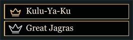

# Iceborn Crown Tracker

An in-game crown display for **Monster Hunter World: Iceborne**. Check a spawn before combat using a notice with the monster’s name and crown category.

**0.1.0-dev.2 — DX11 beta.** Each Iceborn Crown Tracker ZIP includes [Iceborn Suite Core](https://github.com/EnzoAlzueta/IcebornSuiteCore) dev.19 and can be installed on its own. [GitHub releases](https://github.com/EnzoAlzueta/IcebornCrownTracker/releases).

[Install](#install) · [Controls](#default-controls) · [Language](#language) · [Validation](#validation) · [Build](#build-and-contribute)

## Features

- Filter mini gold, large gold and large silver independently.
- Keep a fixed list while monsters are present, or show timed notices for 1–120 seconds.
- Move and scale the list and adjust foreground and background opacity independently.

## Install

Close the game. From Steam, choose **Manage → Browse local files**. Extract one ZIP into the folder containing `MonsterHunterWorld.exe` and keep the directory structure.

| Your setup | ZIP to use |
|---|---|
| Clean game folder with no root loader | **Clean Install** includes the suite bootstrap. |
| Stracker already loads plugins, or the suite bootstrap works | **Existing Loader** installs the files under `nativePC`. |
| Adding a second tracker to this release | **Existing Loader** uses the same shared Core files. |

Keep any existing root loader, settings and hunt files. The standalone Damage Meter bootstrap loads only the meter. Running both mods requires a loader that also loads the suite adapter from `nativePC/plugins`. Keep newer shared files when adding an older package.

## Default controls

| Key or setting | Action |
|---|---|
| F6 | Open Core settings, then select Crowns. |
| Keep list visible | Keep notices on screen while the monster is present. |
| Duration | Set the display time when the fixed list is off. |
| F10 | Open Core settings alongside a legacy Damage Meter. |

## Choosing your filters

Both gold categories are enabled by default. Enable Large silver crown to add large silver results. The initial fixed list is placed in the lower-left corner.

## Language

The HUD follows the game language selected in Steam. Supported languages are English, Spanish, Portuguese, French, German, Italian, Japanese, Korean, Simplified Chinese, Traditional Chinese, Russian, Polish and Arabic. Latin American Spanish uses Spanish menus and its own game text. Crown notices use the same localized monster names as Monster Info. To override detection, set Language under `[ui]` in `nativePC/IcebornSuite/user/core.ini` (for example, `Language=es-419`). Restart after editing the file.

## Requirements and limits

Monster Hunter: World / Iceborne on Windows x64, supported Steam executable build 421810 and DirectX 11.

The threshold table covers 61 eligible species. Fixed-size and special encounters may be excluded. A size notice is a prediction. The game determines the crown awarded.

## Validation

A live sampler classified three Great Jagras in event quest 67106 before combat. Fixed and timed displays, category filters and respawns passed isolated DX11 checks. On-screen notice timing in a guaranteed-crown encounter still needs player confirmation.

Isolated DX11 rendering tests with Core dev.19 covered all 13 interface languages and the Latin American Spanish variant.

## Troubleshooting and removal

Check `nativePC/IcebornSuite/user/core-dev5.log` for the supported build and loaded modules. Preserve `core.ini` and the Damage Meter settings, history and hunt archive.

To remove this version, close the game and remove `nativePC/IcebornSuite/modules/crown-tracker/0.1.0-dev.2/module.dll`. If older versions are installed, remove those module DLLs too to stop fallback. Keep Core for the other trackers.

To disable loading temporarily, set `crown-tracker=0` under `[modules]` in `core.ini` and restart. Set it back to 1 to re-enable.

## Build and contribute

Requires [IcebornSuiteCore](https://github.com/EnzoAlzueta/IcebornSuiteCore) in game. Run `build-module.cmd` with Visual Studio C++ x64 and Python to build the native module and run its fixtures.

Include your Core and module versions, loader, game language and reproduction steps in [bug reports](https://github.com/EnzoAlzueta/IcebornCrownTracker/issues).

## License and notices

Iceborn Suite by Enzo. The shared runtime includes code from Iceborn Damage Meter (MIT) and MinHook (BSD 2-Clause). The package includes the third-party notices. CAPCOM owns the localized game text and the arena artwork in the gallery. Crown size thresholds were checked against HunterPie. See the [size-data provenance](PROVENANCE.md).

## AI disclosure

OpenAI Codex helped prepare the documentation and mod-page text. The preview uses the suite’s HUD renderer and sample data.
